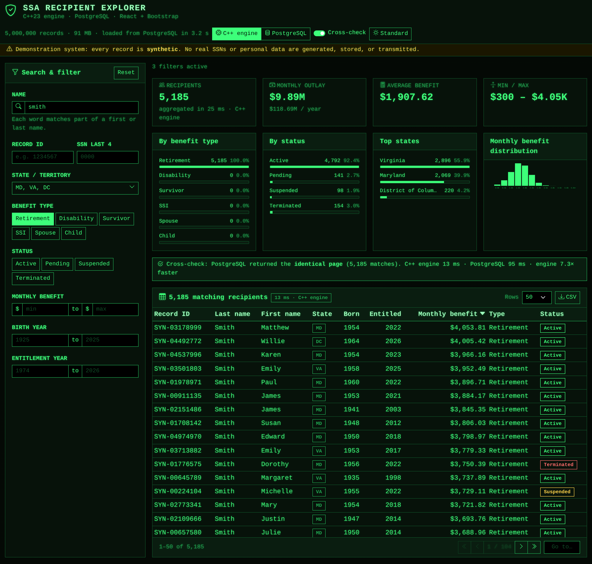

# SSA Recipient Explorer

Interactive search, filtering, sorting and aggregation over **5 million** benefit-recipient records, served by a
C++23 in-memory engine and, side by side, by PostgreSQL 16, with a live cross-check proving both give identical
answers.

> **All data is synthetic.** Records are generated deterministically from a seed. No real SSN or real person is
> ever created or stored: records carry only a masked "last four" and a `SYN-` record id.



## Research question

*For interactive analyst search over millions of records, how much does an in-memory columnar engine gain over a
well-indexed relational database, and can we prove the two return exactly the same answers?*

Short answer on 5M rows (2-core VM): the engine is **2.6–14× faster** on searches and pages, **6–16× faster** on
filtered aggregates and **~84× faster** on full-table aggregates, and sustains **~18× the throughput** under
concurrent load. Across 362 targeted + random
requests the two backends returned **0 mismatches**. Method, numbers and threats to validity are in
[docs/RESEARCH.md](docs/RESEARCH.md); raw results in [docs/results/](docs/results/).

## Architecture

```
 Browser: React 18 + Bootstrap 5.3 (TypeScript, Vite)
    │  JSON over HTTP  /api/query|stats|records ?backend=engine|postgres
    ▼
 ssa_server (C++23, cpp-httplib, thread pool)
    ├── C++ engine: columnar, dictionary-coded, ~19 bytes/record (5M ≈ 91 MB)
    │       ▲ loaded at startup with COPY ... TO STDOUT (5M rows in ~3 s)
    └── SQL backend: libpq, parameterized queries, connection pool, statement timeout
            ▼
 PostgreSQL 16: system of record; trigram + B-tree indexes on every filter and sort key

 No server? The same engine compiles to WebAssembly and runs in a Web Worker (engine/CMakeLists.txt).
```

Both backends parse requests with the same C++ code (`ssa::api::parseQuery`) and format responses with the same
code, so the comparison isolates the query engine itself.

## Quick start: Docker (recommended for the demo)

```bash
cp .env.example .env            # optional: change SSA_RECORDS (default 5,000,000), ports, password
docker compose up --build       # first start builds the image, seeds PostgreSQL (~1 min for 5M), starts the app
# open http://localhost:8080
```

| Service | What it does |
|---|---|
| `db` | `postgres:16-alpine`, data in the `pgdata` volume, published on `127.0.0.1:5432` for psql / IDEs |
| `seed` | one-shot: schema, `COPY` of the synthetic rows, constraints and indexes. Idempotent: skipped once loaded |
| `app` | `ssa_server`: loads the engine from PostgreSQL, serves the UI + API on port 8080; health-checked, non-root |

Useful: `docker compose logs -f app`, `docker compose run --rm seed` (reseed), `docker compose down -v` (wipe data).
Behind a TLS-inspecting corporate proxy: `docker build --secret id=corp_ca,src=/path/ca.pem .` (see `Dockerfile`).

## Developing in CLion or VS Code

Both IDEs read **`CMakePresets.json`** at the repository root: `debug`, `release`, `asan` (AddressSanitizer +
UBSan), `engine-only` (no libpq needed).

**Prerequisites (Ubuntu/Debian):** `sudo apt install g++ cmake libpq-dev postgresql-client nodejs npm`
(Fedora: `sudo dnf install gcc-c++ cmake libpq-devel postgresql nodejs npm`). Docker for the database.

**CLion:** open the folder, enable the `debug` preset when prompted. Shared run configurations in `.run/`:
`ssa_server (PostgreSQL)`, `ssa_server (generated data, no DB)`, `ssa_tests`, `Docker: full stack`.
Start the database first (`docker compose up -d db && docker compose run --rm seed`), and build the UI once
(`cd web && npm ci && npm run build`) so the server can serve it.

**VS Code:** open the folder and accept the recommended extensions (CMake Tools, C/C++, Docker, SQLTools + PostgreSQL
driver, Python). Tasks (`Terminal ▸ Run Task`): build/test presets, `docker: start database`, `docker: seed database`,
`web: dev server`, `research: cross-check backends`, `research: benchmark backends`. Debug configs (F5) for the server
(with or without a database), both test suites, the Python tools and Chrome. SQLTools is pre-configured for the
compose database.

**UI hot reload:** run the server (port 8080), then `cd web && npm run dev` → http://localhost:5173 (proxies `/api`).

### Without Docker

```bash
cmake --preset release && cmake --build --preset release -j && ctest --preset release
export PGHOST=localhost PGUSER=ssa PGPASSWORD=... PGDATABASE=ssa
SSA_RECORDS=5000000 SSA_EXPORT=build/release/engine/ssa_export db/seed.sh
(cd web && npm ci && npm run build)
build/release/server/ssa_server --static=web/dist          # http://localhost:8080
build/release/server/ssa_server --source=generate --static=web/dist   # no database at all
```

## Repository layout

```
engine/      C++23 core: columnar store, filter/search/sort/aggregate, JSON API, builder, tests, benchmark,
             ssa_export (CSV for COPY), ssa_cli; also builds to WebAssembly with Emscripten
server/      ssa_server: HTTP API, PostgreSQL loader (COPY), SQL backend, connection pool, unit tests;
             third_party/httplib (cpp-httplib 0.18.3, MIT, vendored single header)
db/          01_schema.sql, 02_constraints_indexes.sql, seed.sh (idempotent)
web/         React + Bootstrap UI: backend switch, live cross-check, filters, table, aggregates
tools/       compare_backends.py (equivalence), bench_backends.py (benchmark), screenshots.py
experiments/ rust-engine (Rust port comparison), python-engine (NumPy oracle + benchmark)
docs/        RESEARCH.md, DEMO.md, results/, screenshots/, presentation decks and their build scripts
```

## API

All endpoints take `?backend=engine` (default) or `?backend=postgres`; responses are identical JSON apart from
`elapsedMs`. Response headers: `X-SSA-Backend`, `Server-Timing`.

| Method | Path | Body / result |
|---|---|---|
| GET | `/api/health` | `{status, source, records, backends, database, loadSeconds}`; 503 if the database is down |
| GET | `/api/meta` | state/type/status tables, record count, memory, available backends |
| POST | `/api/query` | request below → `{total, offset, limit, elapsedMs, records[]}` |
| POST | `/api/stats` | filter fields only → `{count, sumCents, min/max/avgCents, byState, byType, byStatus, benefitHist}` |
| GET | `/api/records/{id}` | one record, 404 if absent |

```json
{ "text": "mar smi", "states": ["MD","VA","DC"], "types": ["Retirement"], "statuses": ["Active"],
  "minBenefit": 1200, "maxBenefit": 2000, "minBirthYear": 1945, "maxBirthYear": 1960,
  "minEntYear": 2008, "maxEntYear": 2026, "last4": 1234, "id": 42,
  "sort": "benefit", "desc": true, "offset": 0, "limit": 50 }
```
Every field is optional; empty arrays mean "no restriction"; `limit` ≤ 1000. Sort keys: `id lastName firstName
benefit birthYear entitlementYear state`. Each text token must match part of a first **or** last name
(case-insensitive). Errors: `{"error": "..."}` with 400 / 404 / 413 / 500 / 503.

Server options (flag / environment): `--port SSA_PORT`, `--static SSA_STATIC_DIR`, `--source SSA_SOURCE`
(`postgres`|`generate`), `--records SSA_RECORDS`, `--pg SSA_PG_CONNINFO` (else standard `PG*` variables),
`--pool SSA_PG_POOL`, `--timeout-ms SSA_PG_TIMEOUT_MS`, `--threads SSA_THREADS`. Run `ssa_server --help`.

## Research tooling

```bash
python3 tools/compare_backends.py --queries 300     # 62 targeted + 300 random requests; exits 1 on any mismatch
python3 tools/bench_backends.py                     # writes docs/results/benchmark.{json,md}
python3 experiments/python-engine/oracle.py         # independent NumPy re-implementation of the engine
python3 tools/screenshots.py                        # regenerates docs/screenshots (needs playwright)
```

## Verification status

| Check | Result |
|---|---|
| Engine unit tests (incl. builder round-trip) | 120,060 checks pass |
| Server unit tests (SQL translation, COPY parsing, injection) | 39 checks pass |
| Engine vs PostgreSQL, 5M rows | 62 targeted + 300 random requests, **0 mismatches** |
| Checker can fail | 2/2 planted SQL bugs caught (one only after adding targeted tie-break cases) |
| NumPy oracle vs engine | 1,100 random queries, 0 mismatches (earlier phase) |
| AddressSanitizer + UBSan | tests pass; server under real + malformed traffic: no reports, clean shutdown |
| Docker image | builds (tests run inside the build), seeds, becomes healthy, cross-check 0 mismatches, graceful stop |

**Not verified here** (no access in the build environment): the `postgres:16-alpine` service itself (the app
container was tested against a local PostgreSQL 16), the Emscripten/WebAssembly build, CLion and GitHub Actions
running the provided configurations.

## Security and limitations

Demo-appropriate controls are in place: synthetic data only; parameterized SQL only (no string-built queries);
per-statement timeout; 64 KB request limit; strict Content-Security-Policy and other security headers; non-root
container; database port published on localhost only; generic error messages to clients, details in server logs.

Before any real data, this needs authentication and role-based field masking, audit logging, TLS, secrets
management instead of `.env`, a Section 508 audit and a security/privacy review.

Known limitations: the engine is a **snapshot** loaded at startup (database changes appear after a restart; a
next step is `LISTEN/NOTIFY` or logical replication); at most 65,535 distinct first and last names (validated at
load); record ids must be dense 1..N.
